# Smart Restaurant POS — Database Entity-Relationship Diagram (ERD)

**Document Version:** 1.1.0 (Hardened Security Release)  
**Domain Scope:** Phase 1 (Platform Tenancy, Configurations, POS Foundation)

---

## 1. Visual Entity-Relationship Model (Mermaid)

```mermaid
erDiagram
    TENANTS ||--o{ BRANCHES : "operates"
    TENANTS ||--o{ ROLES : "defines"
    TENANTS ||--o{ MEMBERSHIPS : "employs"
    TENANTS ||--o{ RESTAURANT_SETTINGS : "configures"
    TENANTS ||--o{ TAX_SETTINGS : "establishes"
    TENANTS ||--o{ SERVICE_CHARGES : "levies"
    TENANTS ||--o{ MENU_CATEGORIES : "organizes"
    TENANTS ||--o{ MENU_ITEMS : "offers"
    TENANTS ||--o{ ITEM_VARIANTS : "owns_variants"
    TENANTS ||--o{ MODIFIER_GROUPS : "maintains"
    TENANTS ||--o{ MODIFIERS : "owns_modifiers"
    TENANTS ||--o{ DINING_TABLES : "allocates"
    TENANTS ||--o{ AUDIT_LOGS : "records"

    BRANCHES ||--o{ BRANCH_ACCESS : "grants"
    BRANCHES ||--o{ BUSINESS_HOURS : "schedules"
    BRANCHES ||--o{ DINING_TABLES : "houses"
    BRANCHES ||--o{ RESTAURANT_SETTINGS : "localizes"
    BRANCHES ||--o{ TAX_SETTINGS : "applies"
    BRANCHES ||--o{ SERVICE_CHARGES : "applies"

    PROFILES ||--o{ MEMBERSHIPS : "holds"
    PROFILES ||--o{ AUDIT_LOGS : "triggers"
    PROFILES ||--o| PLATFORM_SUPERADMINS : "elevated_to"

    ROLES ||--o{ MEMBERSHIPS : "assigned_to"
    ROLES ||--o{ ROLE_PERMISSIONS : "contains"
    PERMISSIONS ||--o{ ROLE_PERMISSIONS : "granted_by"

    MEMBERSHIPS ||--o{ BRANCH_ACCESS : "scoped_to"

    MENU_CATEGORIES ||--o{ MENU_ITEMS : "groups"
    TAX_SETTINGS ||--o{ MENU_ITEMS : "taxes"
    MENU_ITEMS ||--o{ ITEM_VARIANTS : "has_sizes"
    MENU_ITEMS ||--o{ MENU_ITEM_MODIFIERS : "links"
    MODIFIER_GROUPS ||--o{ MENU_ITEM_MODIFIERS : "linked_to"
    MODIFIER_GROUPS ||--o{ MODIFIERS : "contains"

    TENANTS {
        uuid id PK
        varchar name
        varchar slug "UK (partial)"
        varchar legal_name
        varchar gstin
        varchar currency_code
        varchar currency_symbol
        varchar timezone
        boolean is_active
        timestamptz created_at
        timestamptz deleted_at
    }

    PLATFORM_SUPERADMINS {
        uuid user_id PK,FK
        uuid granted_by FK
        timestamptz created_at
        text notes
    }

    BRANCHES {
        uuid id PK
        uuid tenant_id FK
        varchar name
        varchar code "UK (partial)"
        varchar phone
        varchar city
        boolean is_main_branch
        boolean is_active
        timestamptz deleted_at
    }

    PROFILES {
        uuid id PK "auth.users FK"
        varchar full_name
        varchar phone UK
        text avatar_url
        timestamptz created_at
    }

    ROLES {
        uuid id PK
        uuid tenant_id FK "nullable"
        varchar name
        varchar code
        boolean is_system_role
    }

    PERMISSIONS {
        uuid id PK
        varchar code UK
        varchar category
        text description
    }

    ROLE_PERMISSIONS {
        uuid role_id PK,FK
        uuid permission_id PK,FK
    }

    MEMBERSHIPS {
        uuid id PK
        uuid user_id FK
        uuid tenant_id FK
        uuid role_id FK
        boolean is_active
    }

    BRANCH_ACCESS {
        uuid id PK
        uuid membership_id FK
        uuid branch_id FK
        boolean is_default
    }

    DINING_TABLES {
        uuid id PK
        uuid tenant_id FK
        uuid branch_id FK
        varchar table_number "UK (partial)"
        varchar floor_section
        int seating_capacity
        varchar status
        int version
        timestamptz deleted_at
    }

    MENU_CATEGORIES {
        uuid id PK
        uuid tenant_id FK
        varchar name
        varchar slug "UK (partial)"
        int display_order
        boolean is_active
        timestamptz deleted_at
    }

    MENU_ITEMS {
        uuid id PK
        uuid tenant_id FK
        uuid category_id FK
        varchar name
        varchar short_code "UK (partial)"
        numeric base_price
        varchar food_type
        uuid tax_setting_id FK
        boolean is_available
        int version
        timestamptz deleted_at
    }

    ITEM_VARIANTS {
        uuid id PK
        uuid tenant_id FK "composite FK"
        uuid item_id FK "composite FK"
        varchar name
        numeric price_difference
        boolean is_default
        varchar sku
        boolean is_available
        timestamptz deleted_at
    }

    MODIFIER_GROUPS {
        uuid id PK
        uuid tenant_id FK
        varchar name
        int min_selection
        int max_selection
        boolean is_required
        timestamptz deleted_at
    }

    MODIFIERS {
        uuid id PK
        uuid tenant_id FK "composite FK"
        uuid group_id FK "composite FK"
        varchar name
        numeric additional_price
        boolean is_available
        timestamptz deleted_at
    }

    MENU_ITEM_MODIFIERS {
        uuid tenant_id FK
        uuid item_id PK,FK
        uuid modifier_group_id PK,FK
    }

    TAX_SETTINGS {
        uuid id PK
        uuid tenant_id FK
        uuid branch_id FK "nullable"
        varchar name
        varchar code
        numeric rate_percent
        boolean is_inclusive
    }

    RESTAURANT_SETTINGS {
        uuid id PK
        uuid tenant_id FK
        uuid branch_id FK
        boolean enable_kot
        boolean enable_table_management
        boolean enable_voice_ordering
    }

    BUSINESS_HOURS {
        uuid id PK
        uuid branch_id FK
        smallint day_of_week
        time open_time
        time close_time
        boolean is_closed
    }

    AUDIT_LOGS {
        uuid id PK
        uuid tenant_id FK
        uuid branch_id FK
        uuid user_id FK
        varchar action
        varchar entity_name
        uuid entity_id
        jsonb old_data
        jsonb new_data
        timestamptz created_at
    }
```

---

## 2. Cardinality & Relationship Breakdown

| Parent Entity | Child Entity | Cardinality | Business Logic & Integrity Rule |
|---|---|---|---|
| `tenants` | `branches` | 1 to Many | Brand scales across outlets. Code is unique per tenant (`WHERE deleted_at IS NULL`). |
| `tenants` | `memberships` | 1 to Many | Staff members belong to a restaurant brand. |
| `memberships` | `branch_access` | 1 to Many | Scopes users to authorized physical outlets. |
| `branches` | `dining_tables` | 1 to Many | Physical tables inside an outlet. Table number is unique per branch (`WHERE deleted_at IS NULL`). |
| `tenants` | `menu_categories` | 1 to Many | Category hierarchy is managed at brand level. Slug is unique per tenant (`WHERE deleted_at IS NULL`). |
| `menu_categories` | `menu_items` | 1 to Many | Deleting category restricted if items exist. |
| `menu_items` | `item_variants` | 1 to Many | Cross-tenant reference prevented via composite foreign key `(tenant_id, item_id)`. |
| `modifier_groups` | `modifiers` | 1 to Many | Cross-tenant reference prevented via composite foreign key `(tenant_id, group_id)`. |
| `menu_items` | `menu_item_modifiers` | Many to Many | Links modifier groups to dishes with tenant anchor enforcement. |
| `profiles` | `platform_superadmins` | 1 to Zero/One | Isolated platform operator table. Decoupled from tenant permissions. |
