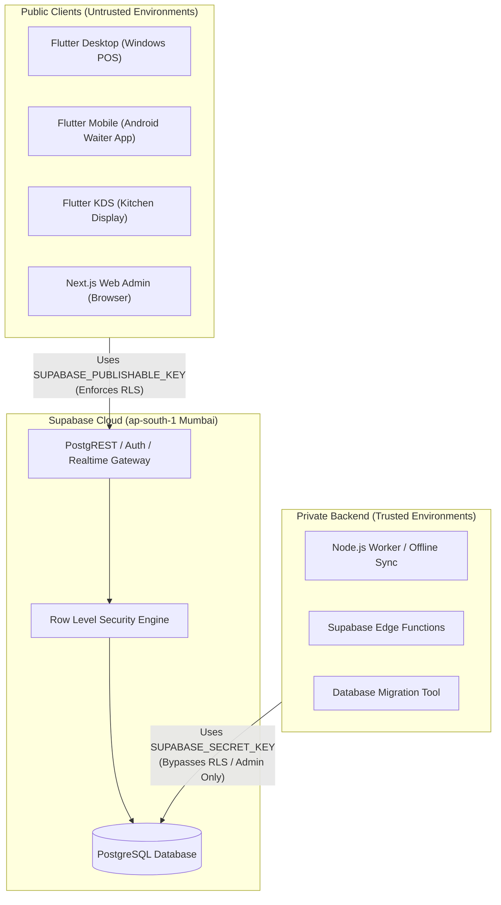

# Smart Restaurant POS — Environment & Supabase Cloud Configuration

**Document Version:** 1.0.0  
**Target Environment:** Development (`dev`)  
**Supabase Cloud Region:** South Asia (Mumbai) — AWS `ap-south-1`  
**Security Classification:** Public Reference / Template (No Secrets Contained)

---

## 1. Cloud Project Overview

The canonical cloud backend for the Smart Restaurant POS SaaS platform is hosted on Supabase Cloud.

| Property | Value |
|---|---|
| **Platform** | Supabase Cloud (Managed PostgreSQL 15+, Supabase Auth, Realtime, Storage) |
| **Project Target** | `smart-restaurant-pos-dev` |
| **AWS Cloud Region** | South Asia (Mumbai) |
| **Region Identifier** | `ap-south-1` |
| **Data Residency** | India (optimized for lowest latency across Indian restaurant outlets) |

---

## 2. Key Architecture & Security Classification

Our architecture strictly separates client-side configuration from server-side administrative access.



### Key Differences & Rules

| Key Type | Canonical Env Var | Next.js Env Var | Target Environments | Security Boundaries |
|---|---|---|---|---|
| **Publishable / Anon Key** | `SUPABASE_PUBLISHABLE_KEY` | `NEXT_PUBLIC_SUPABASE_ANON_KEY` | Flutter Apps (Windows/Android), KDS, Next.js Browser | **Client-Safe.** Enforces strict Row Level Security (RLS). Users can only access data permitted by their tenant membership and role. |
| **Secret / Service Role Key** | `SUPABASE_SECRET_KEY` | N/A (Never expose to Next.js client) | Node.js Worker, Server-side scripts, Edge Functions | **SERVER-SIDE ONLY (HIGH RISK).** Completely bypasses Row Level Security (RLS). **NEVER** embed in Flutter apps, mobile APKs, browser bundles, client source code, or commit to Git. |

---

## 3. Strict Credential Protection Rules

1. **Never Commit Secrets:** `.env` and `.env.local` are explicitly blocked by `.gitignore`. Only `.env.example` is committed.
2. **Never Expose in Logs:** Do not print `SUPABASE_SECRET_KEY`, database connection strings, or user tokens in stdout, logging frameworks, or terminal commands.
3. **Never Bundle in Client Binaries:**
   - Flutter binaries (`.apk`, `.exe`) can be decompiled. Under no circumstances should the service role key be referenced in Dart code.
   - Flutter code must only use `SUPABASE_PUBLISHABLE_KEY` and authenticate users through Supabase Auth JWT tokens.
4. **Local Development Workflow:**
   ```bash
   # Copy template to local override file (ignored by Git)
   copy .env.example .env.local
   ```
   Add your project credentials into `.env.local`. Do not alter `.env.example` with live secrets.

---

## 4. Environment Variables Reference

| Variable | Description | Example / Format | Safe for Clients? |
|---|---|---|---|
| `APP_ENV` | Current runtime environment | `development` / `staging` / `production` | Yes |
| `SUPABASE_PROJECT_REGION` | Supabase Cloud hosting region | `ap-south-1` | Yes |
| `SUPABASE_URL` | Canonical Supabase project HTTPS URL | `https://[ref].supabase.co` | Yes |
| `SUPABASE_PUBLISHABLE_KEY` | Supabase publishable / anon public API key | `eyJhbGciOi...` | Yes (RLS enforced) |
| `SUPABASE_SECRET_KEY` | Supabase service-role administrative secret | `eyJhbGciOi...` | ❌ **NO (Backend Only)** |
| `NEXT_PUBLIC_SUPABASE_URL` | Client URL alias for Next.js App Router | `https://[ref].supabase.co` | Yes |
| `NEXT_PUBLIC_SUPABASE_ANON_KEY` | Client publishable key alias for Next.js App Router | `eyJhbGciOi...` | Yes (RLS enforced) |
