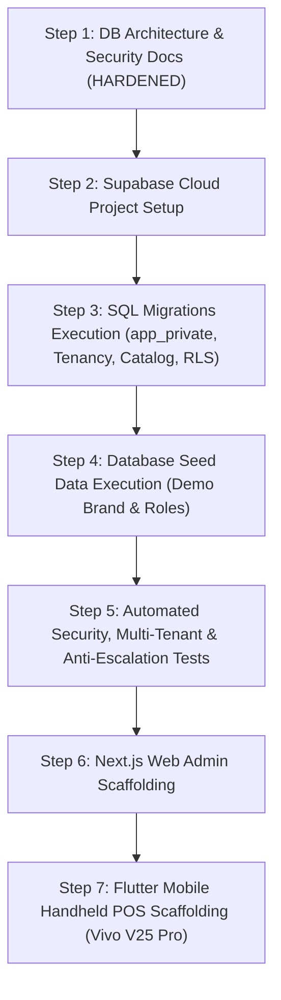

# Smart Restaurant POS — Phase 1 Implementation Plan

**Target Phase:** Phase 1 (Foundation, Multi-Tenant Database, Cloud Auth, and Core Scaffolding)  
**Document Version:** 1.1.0 (Hardened Security Release)  
**Status:** Ready for Execution (Pending Owner Approval)

---

## 1. Phase 1 Scope & Objectives

The primary objective of **Phase 1** is establishing the foundational cloud backend and core repository modules so that all client applications (Flutter POS, KDS, Owner App, and Next.js Dashboards) can securely authenticate and interact with a canonical PostgreSQL database under strict, audited Row Level Security.

---

## 2. Step-by-Step Execution Sequence

---

### Step 1: Architectural Design & Documentation ✅
* **Status:** Complete & Hardened.
* **Deliverables:**
  * `docs/database-architecture.md` (v1.1.0)
  * `docs/database-er-diagram.md` (v1.1.0)
  * `docs/multi-tenant-security.md` (v1.1.0)
  * `docs/roles-permissions-matrix.md` (v1.1.0)
  * `docs/phase-1-implementation-plan.md` (v1.1.0)

---

### Step 2: Supabase Cloud Project Setup & Environment Configuration ✅
* **Status:** Configured & Documented (`.env.example`, `.env.local`, `docs/environment-configuration.md`).
* **Cloud Region:** South Asia (Mumbai), AWS `ap-south-1`.
* **Actions Completed:**
  1. Region confirmed: South Asia (Mumbai) — AWS `ap-south-1`.
  2. Created safe `.env.example` template with canonical and client alias placeholders.
  3. Created local Git-ignored `.env.local` override file.
  4. Documented security classification in `docs/environment-configuration.md` (publishable vs. secret service-role key rules).
* **Next Action:** SQL migration scripts execution (Step 3).

---

### Step 3: Hardened SQL Migration Structure
Create versioned, replayable SQL migrations under `backend/supabase/migrations/`:

| Migration File | Contents & Security Controls |
|---|---|
| `20261114000001_create_app_private_and_tenancy.sql` | • Creates private `app_private` schema (revoked from PUBLIC/anon). • Creates `tenants`, `branches`, `profiles`, `platform_superadmins`. • Revokes client writes on `platform_superadmins`. • Partial unique indexes on soft-deletable columns (`slug`, `code`). |
| `20261114000002_create_rbac_and_audit.sql` | • `roles`, `permissions`, `role_permissions`, `memberships`, `branch_access`, `audit_logs`. • Revokes client `INSERT`, `UPDATE`, `DELETE` on `audit_logs`. • Automated audit triggers in `app_private`. |
| `20261114000003_create_configurations.sql` | • `restaurant_settings`, `tax_settings`, `service_charges`, `business_hours`. |
| `20261114000004_create_pos_foundation.sql` | • `dining_tables` with partial unique index on table numbers. • `menu_categories`, `menu_items`, `modifier_groups`. • Denormalized `tenant_id` and composite foreign keys on `item_variants`, `modifiers`, `menu_item_modifiers`. |
| `20261114000005_create_security_functions_and_rls.sql` | • Implements `app_private.is_superadmin()`, `app_private.get_user_tenant_ids()`, `app_private.has_branch_access()`, `app_private.has_permission()`. • Strict search paths (`SET search_path = app_private, public, pg_temp`). • Non-recursive `memberships_select` policy. • RLS enabled across all public tables with zero-join composite FK checks. |

---

### Step 4: Database Seed Data (`backend/supabase/seed.sql`)
Populate baseline records for end-to-end testing:
* Global roles: `SUPER_ADMIN`, `OWNER`, `MANAGER`, `CASHIER`, `WAITER`, `KITCHEN`.
* Master permissions registry (30+ granular capability keys).
* Demo Tenant: **"Biryani Express"** (Slug: `biryani-express`).
* Demo Branches: **"Indiranagar Outlet"** and **"Whitefield Outlet"**.
* Sample Catalog: 4 Categories, 12 Menu Items with variants, composite FKs, and GST tax rules.
* Sample Floor: 10 Dining Tables across "AC Hall" and "Outdoor Patio".

---

### Step 5: Automated Security & Multi-Tenant Assertion Test Suite
Automated SQL assertions executed against the database:
1. **Tenant Isolation Test:** User under Tenant A executes `SELECT * FROM menu_items`. Verify zero records from Tenant B are returned.
2. **Branch Hopping Test:** Waiter assigned to Branch 1 attempts `UPDATE dining_tables SET status='OCCUPIED' WHERE branch_id=BRANCH_2`. Verify write is rejected (`0 rows updated`).
3. **Cross-Tenant Composite Foreign Key Test:** Attempt to insert an `item_variant` referencing a `menu_item` belonging to another tenant. Verify database rejects with foreign key violation.
4. **Audit Log Tamper Test:** Attempt direct `INSERT`, `UPDATE`, or `DELETE` on `audit_logs` from authenticated client token. Verify PostgreSQL returns `permission denied`.
5. **Anti-Escalation Test:** Regular authenticated user attempts to insert or update `platform_superadmins`. Verify write is rejected with `permission denied`.
6. **Soft-Delete Reuse Test:** Create branch "IND01", soft-delete it (`deleted_at = now()`), and immediately create a new branch "IND01". Verify insertion succeeds cleanly.
7. **RLS Recursion Test:** Query `SELECT * FROM memberships`. Verify execution completes without infinite recursion errors.

---

### Step 6: Frontend App Scaffolding (Connecting to Backend)
1. **Next.js Web Admin (`apps/web_admin`):**
   * Next.js 15 App Router, TypeScript, TailwindCSS, `@supabase/ssr`.
   * Tenant login screen, dashboard layout, and menu catalog management screens.
2. **Flutter Mobile POS (`apps/pos_mobile`):**
   * Connect to Supabase Auth.
   * Test physical connection and login on **Vivo V25 Pro**.
   * Display real-time dining tables and menu catalog.

---

## 3. Risk Management & Rollback Strategy

* **Zero Destruction Policy:** All migrations are reversible using paired `DOWN` migrations.
* **Network Interruption Contingency:** All client apps initialize a local SQLite schema mirroring Supabase remote schema, allowing offline resilience from Day 1.
* **4 GB RAM Safeguard:** Local Docker is bypassed. Supabase Cloud handles database execution, freeing 100% of the PC's memory for lightweight VS Code editing and direct USB mobile debugging.
